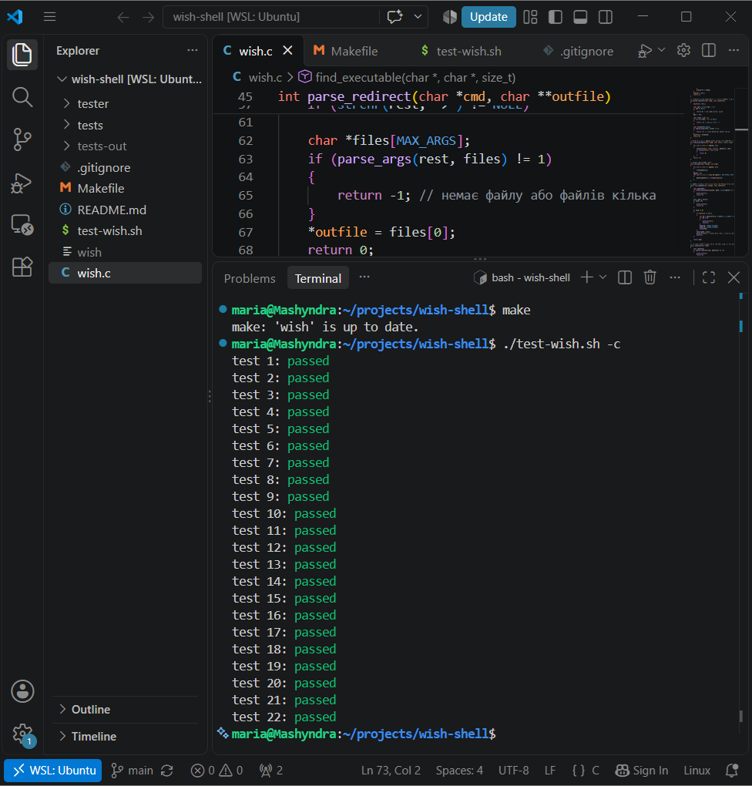

# wish – простий Unix-термінал

Лабораторна робота з дисципліни «Операційні системи».
Реалізація завдання [processes-shell](https://github.com/remzi-arpacidusseau/ostep-projects/tree/master/processes-shell) з курсу OSTEP мовою C.

## Методологія

Робота виконувалась із застосуванням ШІ-асистента Claude (Anthropic) як допоміжного інструменту. Нижче наведено розподіл ролей між асистентом і автором.

### Роль ШІ-асистента

- пояснення теоретичного матеріалу (API процесів, файлові дескриптори) за розділами 4–5 підручника OSTEP;
- декомпозиція завдання на послідовні етапи, кожен з яких відповідає окремому коміту;
- генерація програмного коду для кожного етапу з поясненням його роботи;
- аналіз помилок, виявлених під час тестування.

### Роль автора

- налаштування середовища розробки: WSL (Ubuntu), gcc, make, VS Code, Git, GitHub;
- інтеграція коду в проєкт, компіляція та ручна перевірка після кожного етапу;
- запуск автоматизованих тестів OSTEP після кожної зміни;
- виявлення та усунення помилок інтеграції, зокрема некоректного розгалуження після `fork()`, через яке дочірній процес продовжував виконання як копія інтерпретатора;
- ведення історії комітів, що відображає фактичну послідовність розробки.

### Процес розробки

Розробка велась ітеративно: на кожному етапі додавалась одна функціональна можливість, після чого програма компілювалась із попередженнями (`-Wall -Wextra`), перевірялась вручну та набором із 22 тестів. Кількість пройдених тестів зростала від 0 до 22 у міру реалізації функціоналу.

## Можливості

- інтерактивний режим (`./wish`) і пакетний режим (`./wish batch.txt`)
- запуск програм через `fork`, `execv` і `waitpid`
- пошук програм у папках зі списку path (за замовчуванням `/bin`)
- вбудовані команди `exit`, `cd`, `path`
- перенаправлення stdout і stderr у файл: `ls -la > out.txt`
- паралельні команди: `cmd1 & cmd2 & cmd3`

## Збірка

    make

## Запуск

    ./wish            # інтерактивний режим
    ./wish batch.txt  # пакетний режим

## Тести

    ./test-wish.sh -c

Тести взято з репозиторію [ostep-projects](https://github.com/remzi-arpacidusseau/ostep-projects).
Тест №3 під час запуску перезаписує файл `tests/3.err`; повернути оригінал можна командою `git checkout tests/3.err`.

